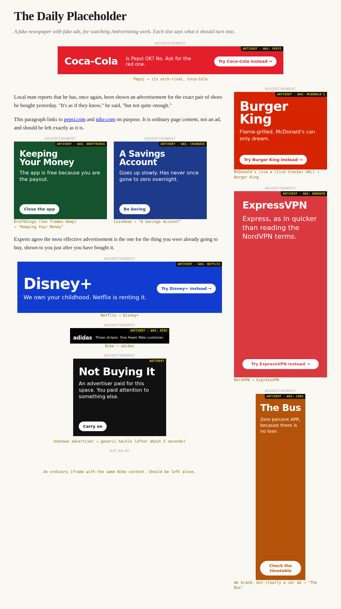

# Antivertising

An ad "blocker" that doesn't block. It replaces each ad with the one its advertiser would least like you to see.

A Pepsi ad becomes a Coke ad. A sportsbook ad becomes an ad for keeping your money. An ad for a car nobody named becomes an ad for the bus.



## Try it

1. Open `chrome://extensions`, switch on **Developer mode**, click **Load unpacked** and pick the `extension/` folder. (Works in Chrome, Edge, Brave and other Chromium browsers; not Firefox yet.)
2. Start the demo page, which is a fake newspaper full of fake ads:

   ```bash
   python3 -m http.server 8377 --bind 127.0.0.1 --directory demo
   ```

3. Open <http://localhost:8377/>. Each slot is labelled with what it should turn into.

Then browse normally. The toolbar badge counts swaps on the current page, and the popup keeps score.

## How it decides

For every ad slot it finds, the extension:

1. **Works out who paid.** It reads the ad's link targets (including landing pages buried inside click-tracker URLs like `...doubleclick.net/click?adurl=https%3A%2F%2Fpepsi.com`) and its visible text, and matches them against the brand database. If no brand matches, ad copy can still give away the category ("lease", "test drive", "SUV" is a car ad).
2. **Picks the most damaging replacement.** Every option has a damage score from 1 to 10:
   - the **arch-rival** scores 9 (the sale goes straight to the competitor they fear most)
   - any **other rival** in the category scores 7
   - the category's **nemesis**, the thing that makes the whole industry unnecessary, has its own score: tap water is a 6 against soft drinks, a savings account is a 10 against crypto.

   *Max damage* mode takes the highest score. *Rival* and *Nemesis* modes force one or the other.
3. **Swaps it in**, at exactly the size and position of the original.

Ads it finds but can't identify get a generic anti-consumption heckle after about five seconds (this can be switched off).

The damage scores are editorial judgement, not measurement. Nobody has run the study.

### House rules

- **Gambling ads never become other gambling ads**, in any mode. They always get the nemesis.
- Every card carries a corner flag saying what it replaced. Hover it for the disclaimer, click it to get the original ad back.
- Nothing leaves your browser. There is no server, no analytics, no affiliate links. Rival cards link to the rival's ordinary homepage.
- The counter-ads are original parody written for this project. They are not real ads, and no brand named here has endorsed, paid for, or been consulted about any of it.

## Adding brands

Everything lives in [extension/src/data.js](extension/src/data.js): about 220 brands across 36 categories. A brand looks like this:

```js
b('pepsi', 'Pepsi', '#004b93', ['pepsi.com', 'pepsi.co.uk'],
  'Someone paid for a {orig} ad here. Have a Pepsi instead.',
  { arch: 'coca-cola' })
```

That is: id, display name, card colour, landing domains, the pitch used when this brand replaces someone else (`{orig}` becomes the victim's name), and options. `strict: true` stops an ambiguous name like "Target" or "Max" from matching in ad text; `aliases` adds unambiguous ones.

Run the tests after editing. They check the database for duplicate domains, missing arch-rivals and brands that could be replaced by themselves.

## Tests

```bash
node test/engine.test.js
```

covers advertiser identification and counter-ad selection, with no dependencies.

```bash
python3 test/e2e.py
```

loads the extension into headless Chromium, opens the demo page and checks every slot. It needs `pip install playwright && playwright install chromium`.

## How it works inside

| File | Job |
| --- | --- |
| `src/data.js` | The rivalry database and all the copy. |
| `src/engine.js` | `identify()` and `pickCounter()`. Pure functions, no DOM. |
| `src/content.js` | Top frame only. Finds slots, asks who the advertiser is, swaps. |
| `src/collector.js` | Every frame. Reports its own links and text when asked. |
| `src/background.js` | Relays between frames, keeps score. |
| `src/card.js` | Draws the counter-ad in a closed shadow root. |

The awkward part is that real ads live inside cross-origin iframes, often several deep, which the page cannot read. So the top frame hands each ad iframe a one-off token; the collector inside shows the token to the background worker, which then knows that frame's id and can ask it and every frame nested inside it what the ad links to. Those answers travel over the extension's private message channel, never through the page.

## Known limits

- **Slot detection is conservative.** It recognises the containers the big networks use (AdSense, Google Ad Manager, Amazon, Taboola, Outbrain and common exchange iframes). It does not guess at `.ad` class names, because a false positive would eat real page content. Sites with home-grown ad markup are missed.
- **No video ads.** YouTube pre-rolls and the like are untouched.
- **Identification needs something to read.** An image-only creative whose click goes through an opaque redirect gives no clues, and gets the generic heckle.
- **Tested on the demo page, not yet on the open web.** The demo mimics real ad markup, but real ad networks will find ways to be different.
- The original ad still loads before it is replaced, so its advertiser may still be billed for the impression. Arguably a feature.
